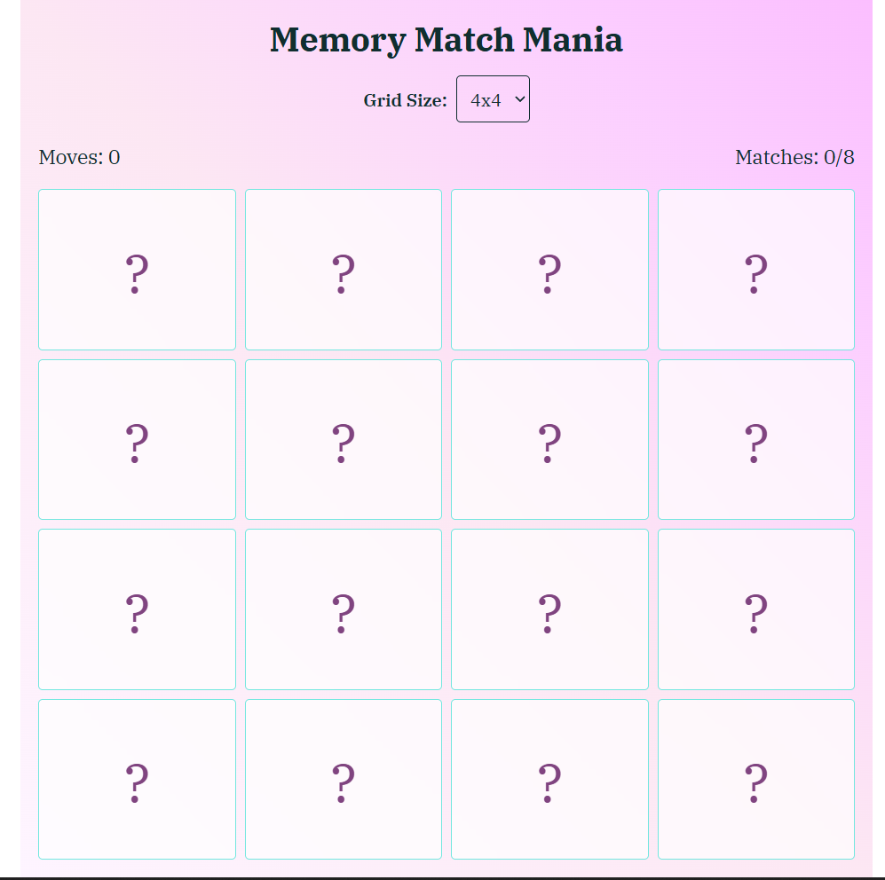
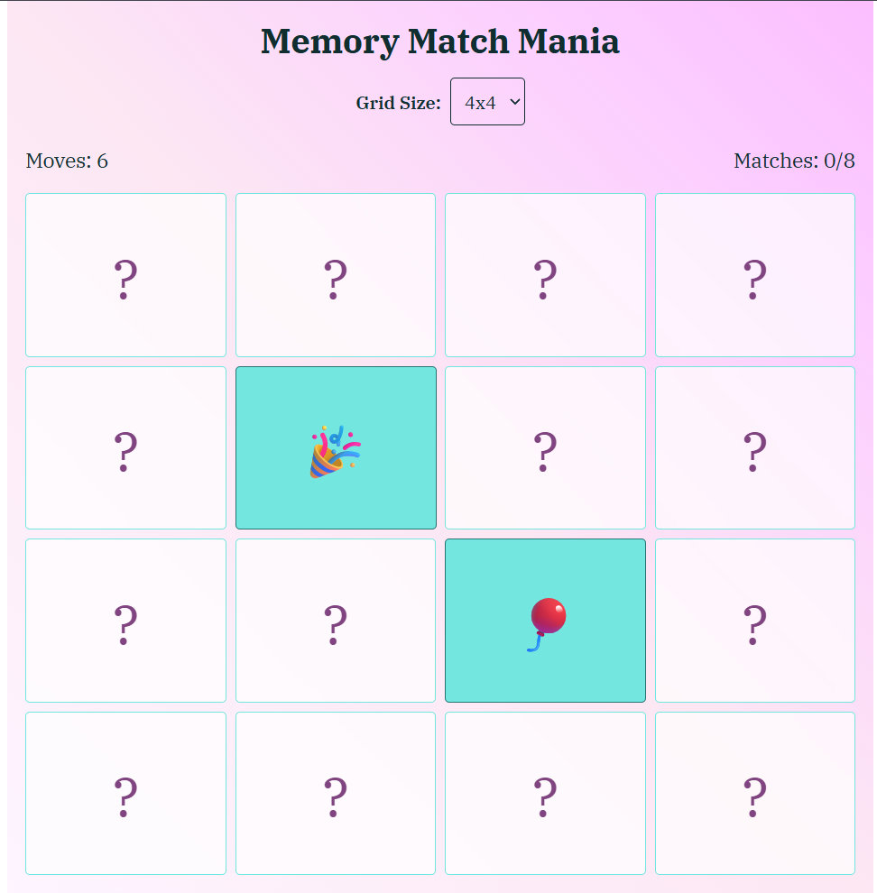
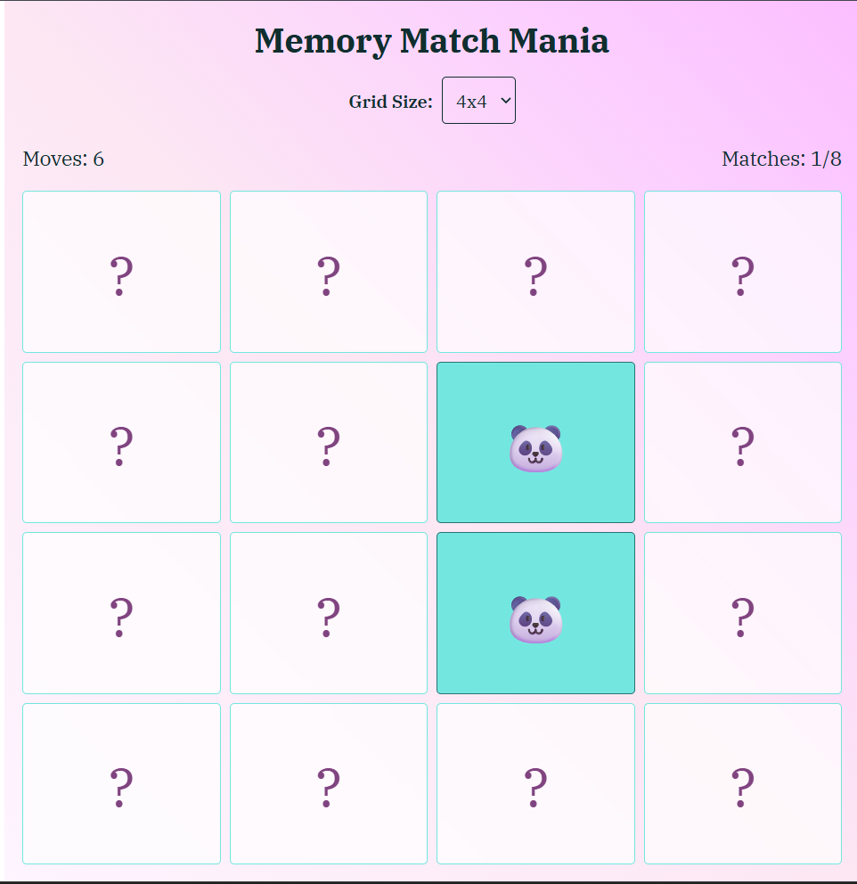

# Memory Match Mania

A browser-based memory card game built with React. Flip cards to find matching pairs, keep track of your moves, and match every pair to win.

You can find the deployment of this code [here](https://rajasi-desai.github.io/Memory-Mania-game/)

## Features

- Choose a 4×4, 6×6, or 8×8 game board.
- Flip cards to reveal icons and find matching pairs.
- Track the number of moves and matched pairs.
- Reset the current game or start a new board size.
- Animated card flips with sound effects.
- Responsive layout for different screen sizes.

## Built with

- React 19
- Vite
- Tailwind CSS

## Getting started

Install the dependencies and start the development server:

```sh
npm install
npm run dev
```

Open the local URL printed by Vite in your browser.

## Available scripts

| Command | Description |
| --- | --- |
| `npm run dev` | Start the Vite development server. |
| `npm run build` | Create a production build in `dist/`. |
| `npm run preview` | Preview the production build locally. |
| `npm run lint` | Run ESLint. |

The deployment configuration targets GitHub Pages at [https://rajasi-desai.github.io/Memory-Mania-game/](https://rajasi-desai.github.io/Memory-Mania-game/).

## How to play

1. **Choose a board size** — Select a 4×4, 6×6, or 8×8 grid. Each board contains matching pairs.
2. **Flip a card** — Click any card to reveal its icon.
3. **Flip another card** — Try to find the matching icon.
4. **Check the pair** — Matching cards stay revealed. If they do not match, they flip back so you can try again.
5. **Find every pair** — Keep playing until all cards are matched. The game tracks your moves and matched pairs.
6. **Play again** — Reset the game or choose a different board size for a new challenge.

## Game mechanics

- **Card flips:** Click a card to reveal it. Flip a second card to test your memory.
- **Matching:** A matching pair remains face-up; a non-matching pair turns face-down again.
- **Moves and progress:** Use the move count and matched-pair total to track your progress.
- **Board sizes:** Larger grids contain more pairs to find.
- **Sound and animation:** Card flips include an animation and sound effect.

## Game images

| Board | Reveal a card | Match a pair |
| --- | --- | --- |
|  |  |  |